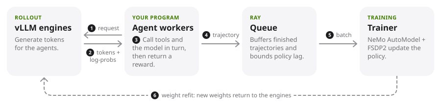

<div align="center">

# 🦋 Molt

**A Hugging Face-native, minimal, and scalable framework for agentic RL research.**

Ray · vLLM · NeMo AutoModel: the smallest Hugging Face-native stack for
fully asynchronous, multimodal, multi-turn agentic RL at 1T-class scale.

<br/>

[](https://nvidia-nemo.github.io/labs-molt/)
[](https://nvidia-nemo.github.io/labs-molt/guide/)

[](LICENSE)


[](https://www.researchgate.net/publication/409325071_Molt_A_Scalable_PyTorch-Native_Training_Framework_for_Agentic_Reinforcement_Learning)
<a href="https://deepwiki.com/NVIDIA-NeMo/labs-molt"></a>

<br/>

[**Project Page**](https://nvidia-nemo.github.io/labs-molt/) ·
[**Docs**](https://nvidia-nemo.github.io/labs-molt/guide/) ·
[**Technical Report**](https://www.researchgate.net/publication/409325071_Molt_A_Scalable_PyTorch-Native_Training_Framework_for_Agentic_Reinforcement_Learning) ·
[**Video**](https://youtu.be/3DqXGFIce0o) ·
[**News**](#-news) ·
[**Architecture**](#-architecture) ·
[**Why Molt**](#-why-molt) ·
[**Installation**](#-installation) ·
[**Quick Start**](#-quick-start) ·
[**Comparison**](#-how-it-compares) ·
[**Documentation**](#-documentation) ·
[**Contributing**](#-contributing)

| Package | SFT | RL | Runtime |
|---|---|---|---|
| `molt` | `molt.cli.train_sft` | `molt.cli.train_rl_ray` | vLLM |

</div>

Molt is **agentic-first**, **Hugging Face-native**, **minimal**, and **scalable**. The agent is the
program: the reward is whatever Python you write in an `Env` or a `ChatAgent`, whether a grader, a
multi-turn tool loop, a VLM environment, or an LLM judge. Three components do the rest. **Ray**
places the processes and runs the async queues, **vLLM** generates the rollouts, and **NeMo
AutoModel + FSDP2** trains a single actor. The model stays an ordinary PyTorch module in the
Hugging Face layout, so one checkpoint directory serves both vLLM and the trainer, with no bridge
to write and no weights to convert. The whole RL path is **~9.2K lines, and it scales to 1T-class
MoE** with TP / EP / CP: the entry point that trains a 4B model on one node also trains GLM-5.2
(753B) at `--fsdp.ep_size 256`, with Adam CPU offload for the largest actors.

## 📰 News

- **2026-11** · Molt powers [REINFORCE Zero](https://github.com/hijkzzz/REINFORCE-Zero). Trainer–inference invariance (TII) and unclipped token-level importance sampling keep asynchronous RL stable through **20,000 policy updates**. See the [guide](https://nvidia-nemo.github.io/labs-molt/guide/?p=is-correction#reinforce-zero) and the [kernel-alignment agent skill](.agents/skills/train-inference-consistency/SKILL.md).

- **2026-09** · [FlashREINFORCE](https://www.alphaxiv.org/abs/2609.flashreinforce-asynchronous-rl-agentic-models) lands in Molt: critic-free, single-rollout RL that trains stably beyond 6,000 steps. Start from the [quick-start script](examples/scripts/quick_start/rl_flash_reinforce_r1d_1p5b.sh).

## 🧩 Architecture

One loop. Six stages.

<p align="center">
  
</p>

Read the figure top to bottom: the loop, what each part provides, and how the trainer scales.
**Ray** places three kinds of processes (agent workers, vLLM engines, and one trainer) and carries
the queue between them. That is the entire runtime. In asynchronous mode the six stages overlap,
so a slow episode delays only itself. The contract is **token-first**: token ids, log-probs, action
ranges, rewards, and multimodal tensors stay aligned from rollout to training. Anything you can
compute in Python is a valid reward, including LLM-as-judge calls back through the same vLLM
engines that drive rollout.

## ✨ Why Molt

| | What you get | Why it matters for research |
|---|---|---|
| 🤖 **Agentic-first** | One Gymnasium-aligned API, `Env.step()` or `ChatAgent.run()`, covers graders, multi-turn tools, VLM environments, and existing agents that speak the OpenAI or Anthropic API | The agent *is* the program. Iterate on environments in plain Python while the trainer stays untouched |
| ⚙️ **Fully asynchronous runtime** | Ray placement, async rollout queues, vLLM engines, partial rollout, weight sync | Rollout, training, and weight sync overlap, so a DeepSeek-V3-class actor stays fed without bespoke infrastructure |
| 🔥 **Hugging Face-native, PyTorch end to end** | The model is an ordinary PyTorch module in the Hugging Face layout (NeMo AutoModel + FSDP2), and one checkpoint directory feeds both vLLM and the trainer | Models load as released, with no bridge to write and no checkpoint to convert. Changing one means editing plain PyTorch |
| 🎯 **Single-actor simplicity** | One actor and an optional KL reference. The whole RL graph fits on a page | Every gradient is explicit, and every loss term is one file away |
| 🚀 **Frontier-scale MoE** | AutoModel + FSDP2 with TP / EP / CP and Adam CPU offload, MoE-native. GLM-5.2 (753B) runs at `--fsdp.ep_size 256` | The 4B and 753B recipes share the entry point, the agent, and the algorithm. Nothing is rewritten between scales |
| 🔗 **Token-first contract** | Token ids, log-probs, action ranges, rewards, and multimodal tensors stay aligned | Multi-turn, VLM, and tool-call traces share one format end to end |
| 🪶 **Small, hackable surface** | ~9.2K lines of RL code in three thin layers. Each mechanism (advantage, loss, token capture, training loop) is one file | The function you edit is the function that runs. Read it in an afternoon, or hand it whole to a coding agent |

## 📦 Installation

Clone the repository first. The launch scripts, agents, and recipes live in it, and the container mounts this checkout.

```bash
git clone https://github.com/NVIDIA-NeMo/labs-molt.git
cd labs-molt
```

### 🐳 Container (recommended)

`dockerfile/Dockerfile` bakes the whole CUDA 13 stack (torch 2.14, vLLM, TransformerEngine, flash-attn,
mamba, DeepEP, NeMo AutoModel) for A100, H100, H200, B200, and GB200. SFT and RL run in it as-is.

```bash
docker pull hijkzzz/molt:latest                                 # or a pinned release: hijkzzz/molt:0.1.10
docker build -f dockerfile/Dockerfile -t hijkzzz/molt:latest .  # to change the CUDA / vLLM / AutoModel pins
```

Tags from 0.1.9 are multi-arch (amd64 and arm64), so the same pull works on x86 and on Grace-Blackwell
hosts. One Dockerfile builds both: publish a tag with
`docker buildx build --platform linux/amd64,linux/arm64 --push`.

### 💻 Local install

For development outside the container. It installs the exact git-pinned AutoModel this repository is
validated against (`setup.py`, `AUTOMODEL`), so R3 routing replay and Muon work out of the box.

```bash
# the vLLM pin is a main-branch commit: its wheels come from vLLM's per-commit index, not PyPI
pip install -e ".[vllm]" --extra-index-url https://wheels.vllm.ai/c32251b5d192f0f72f9ca8c5595d1d43f1dd37b8
```

CUDA 13 is required (`torch==2.14.0+cu130`). A CUDA 12 environment will not work. With a host driver
older than 580, use the container: it ships the CUDA forward-compatibility layer and enables it
automatically.

The `molt-rl` package on PyPI cannot carry the git-pinned AutoModel, so it lags the pin and is not a
supported install path. Use the container or the local install.

### 🪶 Optional backend: AutoModel-Slim

The default is upstream NeMo AutoModel, pinned in `setup.py`.
[`automodel-slim`](https://github.com/NVIDIA-NeMo/labs-molt/tree/automodel-slim) is Molt's own trimmed copy
of that pinned commit, with the same package name, import paths, and API. To opt in, see
[Installation](https://nvidia-nemo.github.io/labs-molt/guide/?p=installation) in the guide.

## 🚀 Quick Start

### 📘 SFT

```bash
torchrun --standalone --nproc_per_node=8 -m molt.cli.train_sft \
  --model.model_name_or_path /path/to/automodel \
  --data.dataset /path/to/sft.jsonl \
  --data.input_key input \
  --data.output_key output \
  --ckpt.output_dir ./ckpt/sft \
  --fsdp.attn_implementation te
```

SFT uses the same AutoModel and FSDP2 model-loading path as RL. Example script:
[`examples/scripts/quick_start/sft_qwen3_4b.sh`](examples/scripts/quick_start/sft_qwen3_4b.sh).

### 🎮 RL

```bash
python3 -m molt.cli.train_rl_ray \
  --actor.model_name_or_path /path/to/automodel \
  --data.prompt_dataset /path/to/prompts.jsonl \
  --data.input_key input \
  --data.label_key answer \
  --train.agent_path examples/python/agents/math.py \
  --vllm.num_engines 2 \
  --vllm.tensor_parallel_size 2 \
  --rollout.batch_size 128 \
  --train.batch_size 128 \
  --train.micro_batch_size 1 \
  --algo.advantage.estimator reinforce \
  --fsdp.attn_implementation te \
  --ckpt.output_dir ./ckpt/rl
```

Example script: [`examples/scripts/quick_start/rl_qwen3_4b.sh`](examples/scripts/quick_start/rl_qwen3_4b.sh).
Every launch script, single-node and Slurm, is in [`examples/scripts/`](examples/scripts).

Sample groups, KL, asynchronous training, IS correction, and evaluation are each a flag or two
away. The [Quick start](https://nvidia-nemo.github.io/labs-molt/guide/?p=quick-start) guide lists
them, and the [RL flags](https://nvidia-nemo.github.io/labs-molt/guide/?p=cli-rl) reference has
every flag.

## 📊 How It Compares

The RL ecosystem optimizes for breadth. Molt optimizes for **agentic research velocity at scale**:
the smallest Hugging Face-native stack that still drives fully asynchronous agentic RL at frontier
MoE scale.

|  | **🦋 Molt** | OpenRLHF | verl | slime |
|---|:-:|:-:|:-:|:-:|
| Training backend | **PyTorch / FSDP2 + NeMo AutoModel** | DeepSpeed ZeRO-3 | FSDP / FSDP2 / Megatron | Megatron (FSDP exp.) |
| Hugging Face models | **native** | native | native on FSDP; bridged on Megatron | bridged (rebuilt in Megatron, weights mapped both ways) |
| Rollout engine | vLLM (Ray) | vLLM (Ray) | vLLM / SGLang / TRT-LLM | SGLang only |
| RL topology | **actor (+ optional PPO critic)** | actor + critic + RM | actor + critic + RM | actor + critic + RM |
| Reward source | **agent Python** | agent / endpoint / RM | agent / RM / endpoint | rollout fn / RM |
| Parallelism | **TP / EP / CP**, MoE-native | ZeRO-3 / FSDP | TP / PP / EP / SP | TP / PP / DP / CP / EP |
| Multimodal | VLM RL, multi-turn tool calls | VLM RL (v0.10+) | Qwen2.5-VL, Kimi-VL | geo3k VLM |
| Config surface | **CLI flags only** | CLI + scripts | Hydra + YAML | CLI + YAML |
| RL code size¹ | **~9.2K LOC** | ~7.2K | ~62K | ~25K |
| Design center | **agentic-first research** | RLHF coverage | production breadth | Megatron throughput |

**One framework, one job.** Molt takes a checkpoint from SFT to frontier-scale agentic RL on vLLM,
with no bridge in between. Read every line that touches your gradients, in plain PyTorch.

<details>
<summary>¹ How the RL-code line counts were measured</summary>

> ¹ RL code = every Python file the framework's RL path uses — online
> trainer, rollout, Ray orchestration, experience/advantage/reward/KL/loss,
> actor/critic/RM inference, plus shared models, utils, parallelism, and
> kernels the RL training command depends on. Excludes pure SFT, DPO/KTO/IPO
> trainers, reward-model **training**, distillation, vendored third-party
> code, tests, examples, scripts, and docs. Counts code lines only (blank
> and comment-only lines excluded). Measured by tracing the import graph
> from each RL entry point (`molt.cli.train_rl_ray`,
> `openrlhf.cli.train_ppo_ray`, `verl.trainer.main_ppo`); slime loads its
> Megatron/SGLang backends lazily, so its core `slime/` package plus its
> `slime_plugins/` model-zoo (+~4.7K — the in-repo model code its RL path
> uses, counted on the same basis as molt's `models/`) are counted, minus
> SFT/distillation. Molt measured 2026-07-20 on this repo; the others
> measured 2026-06-16 at each repo's then-latest main HEAD
> (verl `86e8123`, slime `243773c`, OpenRLHF `b3d2927`).

</details>

## 📖 Documentation

This README is the overview. The [guide](https://nvidia-nemo.github.io/labs-molt/guide/) covers each area in depth.

| Area | Pages |
|---|---|
| Agents and rewards | [Agent contract](https://nvidia-nemo.github.io/labs-molt/guide/?p=agents) · [Recipes](https://nvidia-nemo.github.io/labs-molt/guide/?p=recipes) |
| Training | [Algorithms](https://nvidia-nemo.github.io/labs-molt/guide/?p=algorithms) · [Asynchronous training](https://nvidia-nemo.github.io/labs-molt/guide/?p=async-training) · [IS correction](https://nvidia-nemo.github.io/labs-molt/guide/?p=is-correction) · [Evaluate and debug](https://nvidia-nemo.github.io/labs-molt/guide/?p=evaluate-debug) |
| Scaling | [Scaling](https://nvidia-nemo.github.io/labs-molt/guide/?p=scaling) · [MoE routing](https://nvidia-nemo.github.io/labs-molt/guide/?p=moe-routing) · [MTP rollout](https://nvidia-nemo.github.io/labs-molt/guide/?p=mtp-rollout) · [LoRA](https://nvidia-nemo.github.io/labs-molt/guide/?p=lora) |
| Reference | [RL flags](https://nvidia-nemo.github.io/labs-molt/guide/?p=cli-rl) · [SFT flags](https://nvidia-nemo.github.io/labs-molt/guide/?p=cli-sft) · [`molt.agents` API](https://nvidia-nemo.github.io/labs-molt/guide/?p=api-agents) |

The pages are Markdown files in [`docs/guide/pages/`](docs/guide/pages).

## ✅ Validation

Fast local checks:

```bash
python -m compileall -q molt examples/python tests
pytest -q
```

Container checks:

```bash
SKIP_BUILD=1 DOCKER_GPUS=all DOCKER_SHM_SIZE=32g \
  bash examples/scripts/docker_run.sh "pytest -q"
```

## 🙏 Acknowledgement

Molt builds on OpenRLHF and keeps its Python package layout where practical. The architecture is
deliberately minimal: a Gymnasium-aligned agent (`Env` or `ChatAgent`), a single trainable actor,
optional KL reference workers, vLLM generation, and online policy optimization, all on PyTorch and
NeMo AutoModel.

## 📚 Citation

If you use Molt in your research, please cite:

```bibtex
@techreport{hu2026molt,
  title       = {Molt: A Hugging Face-Native, Minimal, and Scalable Framework for Agentic Reinforcement Learning},
  author      = {Jian Hu and Molt Contributors},
  institution = {NVIDIA},
  year        = {2026},
  url         = {https://www.researchgate.net/publication/409325071_Molt_A_Scalable_PyTorch-Native_Training_Framework_for_Agentic_Reinforcement_Learning}
}
```

## 🤝 Contributing

External contributions are welcome. See [CONTRIBUTING.md](CONTRIBUTING.md). Every commit must be
signed off with `git commit -s`, per the
[Developer Certificate of Origin (DCO)](https://developercertificate.org/).

## 📄 License

[Apache License 2.0](LICENSE). Copyright and third-party attributions are in [NOTICE](NOTICE) and
[THIRD_PARTY_NOTICES.md](THIRD_PARTY_NOTICES.md).
